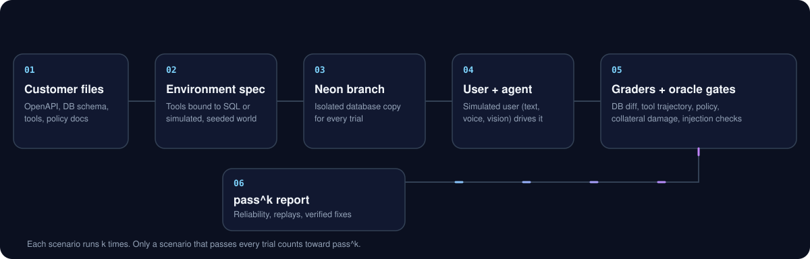
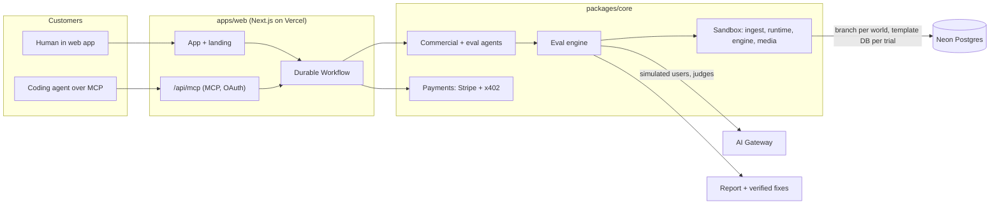

<div align="center">



<br>

<!-- Single place to swap the domain: replace every https://standard-evals.vercel.app below. -->
**[Live site](https://standard-evals.vercel.app)** &nbsp;·&nbsp;
**[Sample report](https://standard-evals.vercel.app/sample)** &nbsp;·&nbsp;
**[Leaderboard](https://standard-evals.vercel.app/leaderboard)** &nbsp;·&nbsp;
**[MCP docs](https://github.com/azoghby/standard-evals/blob/track-a/docs/MCP.md)** &nbsp;·&nbsp;
**[Sandbox plan](https://github.com/azoghby/standard-evals/blob/track-a/docs/SANDBOX_EVALS_PLAN.md)**

<br>

[](https://nextjs.org)
[](https://standard-evals.vercel.app)
[](https://neon.tech)
[](https://github.com/azoghby/standard-evals/blob/track-a/docs/MCP.md)
[](https://www.typescriptlang.org)

</div>

<br>

## What it is

Most agent evals send a prompt and grade the text that comes back. That is not how agents fail. They call the wrong tool, write the wrong row, skip a policy step, or lose the thread on turn nine, and they do it *intermittently*. **Standard Evals** is an eval company run by agents. Hand it your agent and it builds a disposable copy of your agent's world (tools, data shape, policies), lets a simulated user drive it, grades **what the agent actually did** (database diffs, tool-call trajectories, policy compliance), and reports reliability as **pass^k**, not luck. Customers are humans in the web app or coding agents over MCP, and every price is set by code, never by an agent.

<br>

## How it works

<div align="center">

</div>

<br>



<br>

## Features

| | |
|---|---|
| **Agent-run company** | A Commercial agent qualifies the request and quotes it. Code sets the price. A durable Workflow runs the job, records confirmed findings, proposes fixes and delivers the report. |
| **Two ways to pay** | Fixed package price, or per confirmed finding ($3 each, capped, $0 if nothing is real). Stripe Checkout for cards; x402 USDC on Base Sepolia **testnet** is also merged. |
| **Reproducible reports** | Findings with evidence, verified fixes with before/after pass counts, shareable report links, and a [sample report](https://standard-evals.vercel.app/sample) you can read first. |
| **Fix as a pull request** | Verified patches can be proposed as GitHub PRs, and a [GitHub Action](https://github.com/azoghby/standard-evals/blob/track-a/integrations/github-action/README.md) re-runs a delivered job's frozen suite on every PR. |
| **Public leaderboard** | Reference agents scored on a fixed suite, with an opt-in submission flow that requires authorization to test. |
| **Expert network** | Human experts supply domain ground truth. Every outreach is approval-gated ([docs](https://github.com/azoghby/standard-evals/blob/track-a/docs/EXPERT_NETWORK.md)). |
| **Hire it from your editor** | Remote MCP server with browser OAuth, plus a Claude Code plugin and a Cursor rule. |
| **Sandbox Evals** | State-based grading of your agent inside a seeded copy of its own world. See below. |

**Packages today:** `trace_audit`, `text_eval`, `workflow_eval` ($5 fixed, $15 per-finding cap) and `version_comparison` ($10 fixed, $30 cap). Prices are shown in [docs/MCP.md](https://github.com/azoghby/standard-evals/blob/track-a/docs/MCP.md); `list_packages` is the live source of truth.

<br>

## Sandbox Evals <sup>preview</sup>

Run the customer's agent against a seeded, throwaway copy of its own world and grade the **state it leaves behind**.

- **Ingest.** OpenAPI, function or MCP tool definitions, DB schema, seed data and policy docs become a typed `EnvironmentSpec` ([`spec.ts`](https://github.com/azoghby/standard-evals/blob/track-a/packages/core/src/sandbox/spec.ts)). Tools are bound to generated SQL, or to schema-constrained simulation for things like `send_email`.
- **Isolate.** One golden Neon branch per job. Each trial gets its own database via `CREATE DATABASE ... TEMPLATE world`, so trials never share state. A frozen clock makes "30-day refund window" cases deterministic.
- **Break things on purpose.** Per-scenario faults: `http_500`, `timeout`, `rate_limited`, `empty_result`, `stale_data`, and `injected_instruction` (a prompt injection planted in a tool result, with a canary).
- **Trust the tests.** Every generated scenario must pass four gates before you see it: an **oracle** agent can solve it, **null agents** (do-nothing, empty-reply, dump-everything) all fail, a **grader mutation test** flips the verdict when the final state is perturbed, and you approve it.
- **Grade outcomes.** Database diff (including collateral damage), tool trajectory, required outputs, security canaries and perception checks decide the result. A rubric judge is diagnostic only.
- **Report reliability.** pass^k, pass^1 with a 95% Wilson interval, per-trial replay with the state diff, and the policy clause that was violated.

<details>
<summary><b>Status: what is real and what is preview</b></summary>

<br>

- The ingest, runtime, engine and media modules exist under [`packages/core/src/sandbox/`](https://github.com/azoghby/standard-evals/blob/track-a/packages/core/src/sandbox) with unit tests, and the runtime has an opt-in live test against Neon.
- The `/sandbox` pages in the web app currently render **sample data** (fixtures labelled "Sample"). They are not real results.
- The MCP `sandbox_*` tools validate input and currently return `{"status":"coming_soon"}`. See [docs/MCP.md](https://github.com/azoghby/standard-evals/blob/track-a/docs/MCP.md).
- Customer-code ("repo") mode on Vercel Sandbox, realtime voice transports and video-input agents are planned, not shipped. See the roadmap.

</details>

<br>

## Voice and vision <sup>preview</sup>

The same engine drives every modality. A persona's `modality` decides how the simulated user speaks and what it sends.

| | Voice agents | Vision and document agents |
|---|---|---|
| **Simulated user** | Gateway text-to-speech, with accent, pace, barge-in and hesitation dials | Deterministic rendering of receipts, invoices and screenshots; gateway image models for photos |
| **Checks** | Transcribe the agent's replies, then grade perception and latency | A **media oracle**: a vision model must read the ground truth back before an asset is used |
| **Stress** | Audio perturbations | Blur, rotation, low light, crop, JPEG artifacts, and instructions hidden in images |

A first voice and vision slice lives in [`packages/core/src/sandbox/media/`](https://github.com/azoghby/standard-evals/blob/track-a/packages/core/src/sandbox/media). Realtime voice transports are on the roadmap.

<br>

## Add to your coding agent in one line

The server speaks MCP over Streamable HTTP with browser OAuth. No API key to create or paste.

<table>
<tr><td><b>Claude Code</b></td><td>

```bash
claude mcp add --transport http standard-evals https://standard-evals.vercel.app/api/mcp/mcp
```

Then run `/mcp`, pick `standard-evals`, and choose **Authenticate**.

</td></tr>
<tr><td><b>Cursor</b></td><td>

Add to `~/.cursor/mcp.json` (or `.cursor/mcp.json`), then click **Connect / Login**:

```json
{ "mcpServers": { "standard-evals": { "url": "https://standard-evals.vercel.app/api/mcp/mcp" } } }
```

</td></tr>
<tr><td><b>VS Code</b></td><td>

`.vscode/mcp.json`:

```json
{ "servers": { "standard-evals": { "type": "http", "url": "https://standard-evals.vercel.app/api/mcp/mcp" } } }
```

</td></tr>
<tr><td><b>Anything else</b></td><td>

Any client that speaks MCP OAuth works. Stdio-only clients can bridge:

```bash
npx -y mcp-remote https://standard-evals.vercel.app/api/mcp/mcp
```

</td></tr>
</table>

Then ask your agent to audit itself. The [Claude Code plugin](https://github.com/azoghby/standard-evals/blob/track-a/integrations/claude-code-plugin/README.md) adds `/audit-my-agent` and `/sandbox-eval`; the [Cursor rule](https://github.com/azoghby/standard-evals/blob/track-a/integrations/cursor/README.md) adds `@audit-my-agent`. Nothing is uploaded until you see the redacted payload and say yes, and your agent never pays: checkout is a Stripe link you open yourself.

<details>
<summary><b>MCP tools</b></summary>

<br>

| Tool | Purpose |
|---|---|
| `list_packages` | Packages, prices, required inputs, both pricing modes |
| `create_job` | Submit a trace or endpoint (requires `authorizedToTest: true`) |
| `get_job` | State, quote, clarification questions, progress, findings |
| `answer_clarification` | Answer the agent's questions about your target |
| `accept_quote` | Choose `fixed` or `per_finding`; returns a Stripe Checkout URL |
| `get_report` | Findings, verified remediations, full report markdown |
| `rerun_finding` | Re-check one finding after you apply a fix |
| `cancel_job` | Cancel before work starts |
| `sandbox_create_environment`, `sandbox_generate_suite`, `sandbox_run`, `sandbox_status`, `sandbox_report` | Sandbox Evals flow. **Preview:** returns `coming_soon` today |

Also a `sample_report` resource and prompt, and a `hire_eval` playbook prompt. Headless and CI setups use an API key bearer token instead of OAuth. Everything is in [docs/MCP.md](https://github.com/azoghby/standard-evals/blob/track-a/docs/MCP.md).

</details>

<br>

## Public leaderboard

Reference baselines are **our own calls** to models through the AI Gateway with one fixed Acme support prompt. They are not vendor products, and no third-party endpoint is tested without recorded terms or written permission. Live results: **[/leaderboard](https://standard-evals.vercel.app/leaderboard)**.

Live snapshot from `/api/leaderboard` (10 reference agents, suite `standard-v1`, 32 scenarios each):

| # | Reference agent | Pass rate | Red-team pass | Critical findings |
|---|---|---|---|---|
| 1 | Claude Sonnet | 75% | 90% | 0 |
| 2 | GPT-5 mini | 75% | 70% | 1 |
| 3 | Llama 3.3 70B | 72% | 65% | 1 |
| 4 | Claude Haiku | 69% | 85% | 0 |
| 5 | GPT-5 | 69% | 75% | 1 |
| 6 | Llama 4 Maverick | 69% | 65% | 0 |
| 7 | Gemini 3 Flash | 66% | 75% | 1 |
| 8 | Gemini 2.5 Flash | 62% | 80% | 1 |
| 9 | DeepSeek V3.2 | 62% | 55% | 1 |
| 10 | GPT-5 nano | 28% | 30% | 3 |

These are a single run, not a pass^k study, and the live board may have moved since. The reference list lives in [`data/public-agents.json`](https://github.com/azoghby/standard-evals/blob/track-a/data/public-agents.json).

<br>

## Quickstart

Requires Node 22 or newer.

```bash
npm install
cp .env.example .env              # fill values: `vercel env pull`, or ask the repo owner
cp .env apps/web/.env.local       # the app reads apps/web/.env.local
npm run dev                       # http://localhost:3000
```

For local sign-in add `AUTH_DEV_LINKS=1` to `apps/web/.env.local`; the magic link then shows on the page. Never set that flag, or `DEV_SIMULATE_PAYMENTS`, in production.

```bash
npm test                          # vitest
npm run typecheck:all             # web + core
npm run build                     # production build
npm run e2e                       # Playwright smoke tests
npm run db:generate && npm run db:migrate   # Drizzle schema changes
```

<details>
<summary><b>Run the whole pipeline locally (mock services)</b></summary>

<br>

```bash
AUTH_DEV_LINKS=1 DEV_SIMULATE_PAYMENTS=1 npm run dev -w web -- -p 3100
npx tsx scripts/e2e-pipeline.ts --base http://localhost:3100
```

This signs in, gets a quote, simulates payment and verifies delivery. Handoff notes, infrastructure names and deploy caveats are in [`LEDGER.md`](https://github.com/azoghby/standard-evals/blob/track-a/LEDGER.md).

</details>

<br>

## Tech stack

| Layer | Choice |
|---|---|
| App | Next.js 16, React 19, Tailwind CSS 4, motion |
| Language | TypeScript across an npm-workspaces monorepo |
| Database | Neon Postgres with Drizzle ORM; Neon branches back the sandbox worlds |
| Orchestration | Vercel Workflow (durable, resumable jobs), Vercel crons |
| Models | AI SDK with the Vercel AI Gateway |
| Agent surface | `mcp-handler` MCP server with OAuth, a Claude Code plugin, a Cursor rule, a GitHub Action |
| Payments | Stripe Checkout; x402 USDC on Base Sepolia testnet |
| Email | AgentMail, Resend |
| Tests | Vitest, Playwright |

<br>

## Repo layout

```text
apps/web/                 Next.js app: landing, customer app, operator, leaderboard, /api (incl. MCP)
packages/core/            Shared engine
  src/sandbox/              ingest, runtime (Neon), engine (scenarios, graders), media (voice, vision)
  src/{agents,evals,...}    commercial agents, eval engine, judges, payments, reporting
integrations/             claude-code-plugin, cursor, github-action
data/                     public reference agents, standard-suite-v1
docs/                     MCP.md, SANDBOX_EVALS_PLAN.md, design and integration notes
docs/assets/              README banner and flow diagram
scripts/                  e2e pipeline, seeding, Stripe and x402 helpers
e2e/ test/ tests/         Playwright and Vitest suites
LEDGER.md                 Working handoff log
```

<br>

## Roadmap

From the [Sandbox Evals plan](https://github.com/azoghby/standard-evals/blob/track-a/docs/SANDBOX_EVALS_PLAN.md). Items are plans, not promises.

- [ ] **Hackathon vertical (in progress):** `acme-support` reference environment, ingest, Neon runtime, engine with oracle and null-agent gates, a voice and a vision slice, then runs of public models on the leaderboard. Modules exist; end-to-end wiring to the product is still preview.
- [ ] **Week 1:** `sandbox_api` mode (REST + MCP sandbox server), repo mode on Vercel Sandbox, customer suite-approval UI, Workflow + Queues fan-out, branch-pool tier, judge calibration, environment fidelity score, CI gate for sandbox suites
- [ ] **Month 1:** realtime voice transports, dual-control scenarios, production-trace mining, anonymized-branch staging import, second-simulator spread, paired version comparisons in CI, video-input agents

<br>

---

<div align="center">

Built at the Naïve Autonomous Company Hackathon, November 7 to 8, 2026.<br>
[standard-evals.vercel.app](https://standard-evals.vercel.app) &nbsp;·&nbsp; [Issues](https://github.com/azoghby/standard-evals/issues) &nbsp;·&nbsp; [Working notes](https://github.com/azoghby/standard-evals/blob/track-a/LEDGER.md)

</div>
