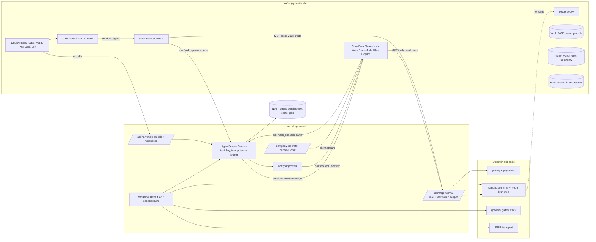

# Running Standard Evals on Naïve managed agents (maximal plan)

Owner: Alex (Track B), with Ronit (Track A). Status: proposal. Written 2026-11-07 against `origin/main` @ `e8e33c4` and `@usenaive-sdk/managed-agents` 0.12.3.

## Phase 0 status (2026-11-07, ~23:00 PT)

Run by Track A on branch `naive-p0`. Prod is unchanged (`EVAL_SERVICES=lite`, no deploy).

| Item | Result |
|---|---|
| Key | New `NAIVE_API_KEY` verified read-only. The org had one agent (`CEO`) and one session; nothing else was touched. Naïve often answered 429 "service is at capacity". |
| Provisioning | `scripts/naive-provision-roles.ts` (dry-run default; `--apply`; `--write-env`) runs `ensureAgents` with `namePrefix: "standard-evals-"` and Alex's attestation. Created: `standard-evals-commercial` `agt_d4ez98rqx4tzdqez2xhjz63ssc`, `standard-evals-evaluation-engineer` `agt_vd9rq2nr7jcd9z488k8kfpb4s2`, `standard-evals-quality-investigator` `agt_841hcrd40mpr6tp2vsahtcnsvs`, `standard-evals-company-operator` `agt_gjshx93weag6k5nhcedq9wx6p3`. All v1, tools denied, no MCP or skills, `handoffs:false`, per-task caps $1 to $1.50. A re-run verifies them and creates nothing. Pinned as `<id>@1` in `.env` and Vercel production. Skills, outcomes, vault and deployments are not provisioned yet (no role needs them in Phase 0); Track B's staged, journaled `scripts/naive-provision.ts` (2c0c7f7) covers the company-role manifest. |
| Migrations | `001-agent-persistence.sql` and `001_branch_ownership.sql` are additive only. Applied on Neon branch `naive-p0-2026-11-08` with constraint smoke checks, then on main. Test branch deleted. `001_calendar.sql` (sim seed) not applied. |
| Budget-0 | Refused in Track B's adapter (`=== 0`) and at our seam (`integration/compose.ts`, `<= 0` or non-finite) before any agent service is built. |
| Conformance (`--services real`) | 13 PASS, 2 FAIL, 1 SKIP. Below. |
| Live smoke | `scripts/naive-smoke.ts`: qualify (`quote`) and renderReport on a fresh fixture job (customer `sandbox-e2e@example.com`). PASS: both tasks `completed` with session ids in `agent_persistence.tasks`, two `costs` rows `source=naive` with session ids, $0.0076. |
| Spend | About $0.11 of Naïve sessions across all runs. No AI Gateway spend. |

Conformance, real services:

| Check | Result |
|---|---|
| qualify: output parses (trace_audit / text_eval) | PASS / PASS (`quote` / `clarify`) |
| qualify: never returns a price | PASS (an earlier run got `needs_operator`: the session stopped `awaiting_approval`) |
| auditTrace: unsupported claim / clean trace | PASS / PASS |
| checkTarget: 5 blocked URLs | PASS x5 |
| renderReport | PASS |
| proposeAndVerifyFix | FAIL: `EvalServiceUnavailableError` (no Track B engine; the app falls back to lite) |
| designSuite | FAIL: `EvalServiceUnavailableError` (text engine not mapped; the app falls back to lite) |
| runSuite | SKIP (no live target given) |
| budget (0 budget) | PASS |
| branching: create, connection, delete | PASS |

Fixes on our side:

- Track B pools use `DATABASE_URL_UNPOOLED`. The branch ledger's session advisory lock failed through the PgBouncer pooler (`branch_ledger_unlock_failed`).
- The real-services conformance runner gives each check its own internal-fixture job. Task keys are job + role + purpose, so distinct requests on one job collided.
- The runner retries typed pending or retryable errors the way the Workflow does: Naïve 429, async branch delete, `branch_not_ready`.

For Alex (Track B):

1. The commercial agent once stopped `awaiting_approval` with all tools denied (qualify with the clarification "Please quote $1"). It became `needs_operator`. What triggers an approval stop with no tools?
2. Naïve capacity 429s hit `agents.get` and `getVersion` right after create, so `ensureAgents` reported `creation_uncertain` on each of the first runs. Re-runs were safe. A bounded retry on 429 for reads would help.
3. The task store holds three tasks in state `ambiguous` (no session id) for job `11111111-…` from a rate-limited run. They keep their reservations until reconciled.
4. `proposeAndVerifyFix`, `designSuite`, `runSuite`, `investigate` and `rerunFinding` are still unmapped (Phase 1).

Left for Phase 1: map the five remaining methods; apply `001_calendar.sql` to the sim seed and `001-text-integration.sql`; run conformance with `--target-url`; switch a Preview deployment to `EVAL_SERVICES=real` before prod.

---

## Track B continuation (2026-11-07, after Track A `96e1069`)

Track A's results above are preserved. Track B independently created and attested four version-1 skills and three advisory outcomes using the staged, journaled CLI, then created four tool-denied `ae-*` diagnostic agents. These are **separate from the `standard-evals-*` application pins**; no app environment pins or deployments were changed. Nonsecret IDs, hashes and session receipts are in `docs/naive-phase0-live-receipts.json`.

The four-role diagnostic completed at $0.25/session / $1 total limits, consuming **29,444 micro-USD ($0.029444)**. Commercial qualified the fixture, the engineer produced two scenarios, the investigator confirmed the unsupported booking claim, and the operator summarized it. Replaying the same file-backed task state returned the same four session IDs and costs. This validates these four SDK/session paths, **not PostgreSQL settlement or expanded-role acceptance**.

Current additional implementation:

- Staged roster builder with explicit revision names, verified `slug@N` skill references, exact dependency receipts and paused deployment bodies. Missing MCP authorization, private bearer files, schedules or callbacks remain blocking inputs.
- Diagnostic requires explicit directory pins and budget period, performs read-only attestation and never provisions or increases its $1 envelope.
- Lossless rich-text/contract projection retains authorized immutable sidecars. Text design/run contract wrappers now exist with required owner authorization/admission/run-storage ports, but are not composed into the application. Boolean `RunResult` cannot represent rubric/inconclusive/infrastructure states and those projections fail closed. New remediation proposals use Ines with durable role pinning; incomplete unpinned legacy proposals block for reconciliation.
- Cost adapter rejects unmeasured or unidentified receipts. Application sinks still require atomic keyed settlement; see `docs/naive-cost-settlement-handoff.md`.

Phase 0 is still open: full real conformance, remaining migrations, expanded-role resources/authorization, and staging/application acceptance remain gates. Production remains unchanged by this work.

---

Goal: **every agentic role in the company runs on Naïve**, using every relevant Naïve capability the SDK actually offers. Only the deterministic, safety-critical pieces stay as our code.

Each claim carries one of two labels:

- **[Fact]**: checked in code on `origin/main`, in the SDK `dist/index.d.ts` or README, or on the public Naïve docs (usenaive.ai/docs: api/overview, api/agents, api/sessions, capabilities/tools).
- **[Proposal]**: a recommendation that has not been built yet.

No secret values appear in this document. Env vars are listed by name only.

---

## 1. TL;DR and current state

### TL;DR

1. **[Fact]** Today only `qualify`, `auditTrace` and `renderReport` can run on Naïve, and only with `EVAL_SERVICES=real`. Prod runs `EVAL_SERVICES=lite` with no `NAIVE_*` keys, so **production makes zero Naïve calls**. Every model call goes through the Vercel AI Gateway (`packages/core/src/ai/gateway.ts`).
2. **[Proposal]** All 14 roster agents become Naïve agents or Naïve-run workloads. Ten are managed agents with pinned versions, `output_schema`, budgets and approval gates. Cass runs as a Naïve **coordinator** with a team **board**. Remy and Jude run on Naïve (per-episode sessions and batch judge sessions, with the sessionless **model proxy** for the hot path). The per-eval chat gets a Naïve copilot. Mara, Pax, Otto, Lev and Cass run on Naïve **deployments** (cron). See §2.
3. **[Proposal]** We use the full Naïve surface:
   - sessions, structured output, idempotency, budgets
   - built-in web tools and MCP tools through **vault-injected credentials**
   - `ask` and `ask_operator` for human-in-the-loop
   - deployments with `on_idle` callbacks, coordinator, board and handoffs
   - outcomes (rubric revision loops), skills, files, model selection and proxy
   - streaming, span events, spend and webhooks

   Capability by capability with verification: §3.
4. **[Fact]** Gaps in SDK 0.12.3:
   - **No persistent memory** API.
   - **No client-executed custom tools** ("coming soon" in the docs).
   - **Inline MCP auth headers are rejected**: credentials must come from the vault.
   - **No documented data region.**
   - The webhook event list is not documented.

   The closest workable pattern for each is in §3.
5. **[Proposal]** What stays code, and why: pricing and payments, auth/OAuth, the SSRF guard and target transport, Neon branching and the sandbox runtime, graders' SQL/diff/outbox checks and quality gates, statistics, budget ledgers, and the final send/no-send decision. Agents propose; code decides money, access and pass/fail. Rollout is five phases, each with an env-flag rollback (§5).

### What is wired to Naïve today [Fact]

| Surface | Where | State |
|---|---|---|
| SDK adapter | `packages/core/src/agents/naive-adapter.ts` | Only SDK import. 30 s request deadline. Errors classified as ambiguous / rate_limited / in_flight / definitive. |
| Durable runner | `packages/core/src/agents/session-service.ts` | Task key `jobId:role:purpose:attempt`, deterministic idempotency key, intent row before create, lease, Zod-validated `structured_output`, reservation then settle. Re-entrant from Workflow steps. |
| Persistence and ledger | `agents/postgres-ports.ts`, `agents/persistence-migrations/001-agent-persistence.sql` | Code done. **Migration not applied anywhere** (LEDGER §5). |
| Four role agents (v1) | `agents/roles.ts`, `agents/provision.ts` | `ae-commercial`, `ae-evaluation-engineer`, `ae-quality-investigator`, `ae-company-operator`. Tools denied, `mcp_servers: []`, `handoffs: false`, `GLM-5.2-FP8`. IDs are in `docs/track-b-agents.md`. |
| Domain services | `agents/commercial.ts`, `agents/operator.ts`, `evals/trace/audit.ts`, `evals/text/*` | Code-side checks: invented prices, unknown finding IDs, "confirmed" mislabels, exact-quote citations. |
| Contract adapter | `evals/service-adapter.ts`, `integration/{compose,eval-services}.ts` | 3 of 11 methods. `designSuite`, `runSuite`, `investigate`, `proposeAndVerifyFix` and `rerunFinding` throw `EvalServiceUnavailableError`; under `real` they fall back to lite (`apps/web/src/server/services.ts` `withLiteFallback`). |
| Autonomy envelope | `agents/autonomy/*`, `autonomy/operations.sql` | Code and PGlite tests only. Not composed or migrated. |
| Live evidence | `docs/track-b-agents.md` | Four-role probe $0.026. Investigator confirmed/control probes $0.017 / $0.012. **A $0.10 per-session cap was refused with 402 at pre-flight; $0.25 passed.** |

### Why prod is on lite [Fact]

- The LEDGER §5 NO-GO list for `real` is still open:
  1. Naïve keys are not set.
  2. Migrations are not applied.
  3. Budget-0 refusal is missing (`service-adapter.ts` treats `ctx.budgetMicroUsd` as information only).
  4. Conformance has not been rerun on `real`.
- Lite covers all 11 methods and passed conformance live (18/18), so it shipped.

### Everything currently not on Naïve (AI Gateway)

| Area | Files |
|---|---|
| Lite eval engine | `packages/core/src/lite/{design,run,investigate,audit,fix,report}.ts` |
| Sandbox engine | `sandbox/engine/{generate,simulator,graders}.ts` (LLM), `{gates,runner,episode}.ts` (code), `sandbox/runtime/simulate.ts`, `sandbox/ingest/bindings.ts` |
| Sandbox media | `sandbox/media/*` (TTS, STT, perception) |
| Company agents | `apps/web/src/server/company/{planner,market-research,prospecting,outreach,onboarding}.ts` via `runtime.ts`, `structured.ts`, `web-search.ts` (perplexity/sonar) |
| Owner liaison | `apps/web/src/server/owner-responder.ts` (`OWNER_TOOLS` allow-list) |
| Leaderboard (Lev) | `apps/web/src/server/public-agent-runner.ts`, which calls `createLiteServices` directly |
| Founder notify | `apps/web/src/server/notify/*` (no LLM today) |
| Per-eval chat | `packages/core/src/reporting/chat/*`, deterministic `answers.ts` (no LLM today) |
| Scheduling | Vercel crons (`vercel.json`, `api/cron/company/*`, `api/cron/public-agents`) |

---

## 2. Target architecture

### Roster to Naïve [Proposal]

Shared settings for every agent:

- `structured_output_required: true` and a per-task `output_schema` from the existing Zod schema (`outputJsonSchema`).
- `metadata.ae_role` and `metadata.ae_managed: true`, plus `skills: ["se-house-rules", <role skill>]` (§3).
- Default toolset `deny`. Tools are enabled per row below.
- `max_task_micro_usd` at least $0.30, above the observed pre-flight floor.

| Roster | Naïve agent | Runs as | Tools / Naïve features | Output schema | Budget (mo / task) | Gate (code-owned) |
|---|---|---|---|---|---|---|
| **Cass**, CEO/Planner | `ae-ceo-planner` (new) | **Deployment** `30 6 * * *` with `on_idle` → `/api/naive/idle`. **Coordinator** (`multiagent: {type:"coordinator", agents:[Mara,Pax,Otto,Nova], board:true}`), `handoffs:"team"` | `send_to_agent`, `wait_for_agents`, `list_agents`, `board_read/write`, `write_plan`. MCP `se_internal.get_company_metrics` (allow) | planner plan schema (`server/company/planner.ts`) | $15 / $1 | Cannot raise caps (each member has its own Naïve budget plus our ledger). Plan goes in the daily digest. Toggles pause the deployment. |
| **Cora**, Commercial | `ae-commercial` (**live v1**) | session per qualify round | none | `QualifyAgentOutput` | $35 / $1 | Price only via `buildQuote`; off-menu text replaced. |
| **Mara**, Market Researcher | `ae-market-researcher` (new) | **Deployment** (weekly) plus Cass handoff | `web_search`, `web_fetch` (allow, `max_content_tokens`), `publish_file` (brief artifact) | market brief schema (`market-research.ts`) | $20 / $0.75 | Read-only. Code checks cited URLs against `tool.completed` events. |
| **Pax**, Prospector | `ae-prospector` (new) | Deployment plus handoff | `web_search`, `web_fetch`; MCP `se_internal.save_lead` (allow, writes `prospect_leads` only) | lead schema (`prospecting.ts`) | $20 / $0.75 | Code dedupes by domain and runs the Monid contact lookup. Agent never sees emails. |
| **Otto**, Outreach SDR | `ae-outreach-sdr` (new) | Deployment plus handoff | MCP `se_internal.propose_outreach` (allow → `pending` draft); `se_internal.send_outreach` (**ask**) | `OutreachDraftOutput` | $15 / $0.50 | Every send: `ask` → founder approval → `confirmTool`. Daily cap `outreachDailyCap`. |
| **Ezra**, Eval Designer | `ae-evaluation-engineer` (**live v1**) | session per suite, **outcome** `ocm_suite_quality` (revision loop) | `read_skill` (taxonomy skill) | text suite design (`evals/text/design.ts`) | $65 / $1.50 | Ines review, then code freeze (`evals/text/freeze.ts`). Outcome is advisory, never the gate. |
| **Sloane**, Scenario Writer | `ae-scenario-writer` (new) | session per batch of about 5 slots; outcome `ocm_scenario_quality` | `read_skill`, `fetch_file` (env spec file) | per-slot scenario draft (`sandbox/engine/generate.ts`) | $60 / $1.50 | Deterministic post-processing plus the oracle, null-agent and mutation gates (`gates.ts`). |
| **Remy**, Customer Simulator | `ae-customer-simulator` (new) | **one session per episode**, each turn via `sessions.send` (persona stays in context), or **`proxy.messages`** per turn (flagged) | none | `SimulatorTurn` (`sandbox/engine/types.ts`) | $80 / $0.50 | Sees only the visible conversation and allowed facts (tau2-style). Turn cap and status come from code. |
| **Jude**, Judge | `ae-judge` (new), LLM part only | **batch session per run** (N transcripts → per-check verdicts) or `proxy.messages` | none | rubric verdict schema (`graders.ts` `CheckResult`) | $60 / $1.50 | Deterministic SQL/diff/outbox graders decide the reward. The judge is a fallback or diagnostic only (`isRewardBearing`). |
| **Ines**, Investigator | `ae-quality-investigator` (**live v1**) | session per finding batch | `fetch_file` (trace file), `read_skill` | `TraceRecheckOutput`, text investigation, new `FixProposal` | $65 / $1.50 | Exact-quote citations. A fix counts only after code reruns before/after. |
| **Wren**, Report Writer | `ae-company-operator` (**live v1**) | session; outcome `ocm_report_clarity` | `publish_file` (report draft) | `ReportSummaryOutput` | $35 / $1 | `writeReportSummary` label/ID/price checks. Rendering stays code. |
| **Nova**, Onboarding/CS | `ae-onboarding` (new) | **long-lived session per conversation** (`sessions.send` per customer message) | MCP `se_internal.sandbox_*` (create/generate/run = **ask**, status/report = allow), `ask_operator` | onboarding turn schema (`onboarding.ts`) | $30 / $1 | Code auto-confirms within plan caps; founder approval when over. |
| **Olive**, Owner Liaison | `ae-owner-liaison` (new) | session per owner email thread | MCP `se_internal.owner_*` mirroring `OWNER_TOOLS` (`answer_results` allow; `request_rerun`, `pause`, `set_visibility`, `opt_out`, `start_paid_eval`, invites = ask) | owner action schema (`owner-responder.ts`) | $15 / $0.50 | Code executes the actions. The "What I did" list is built from actual results. |
| **Lev**, Leaderboard Runner | `ae-leaderboard-runner` (new) | **Deployment** `*/15` | MCP `se_internal.list_public_agents`, `start_public_run` (ask, auto-confirmed under `PUBLIC_AGENT_DAILY_BUDGET_USD`), `get_public_run` | run plan schema | $20 / $0.30 | Code runs the eval (`public-agent-runner.ts` through `getEvalServices()`) and scores it (`leaderboard.ts`). |
| **Chat copilot** (per-eval chat) | `ae-eval-copilot` (new) | session per job conversation, `sessions.send` per question; tokens streamed with `client.stream` | MCP `se_internal.get_progress_snapshot` (allow, job-scoped) | `ChatReply` (`reporting/chat/types.ts`) | $20 / $0.20 | Code checks every number and finding ID against the projection. Mismatch falls back to deterministic `answers.ts`. Customer text is never an instruction. |

Budget figures are sizing proposals. Calibrate them after a week of `agents.spend`.

### What stays deterministic code, and why

| Capability | Location | Why |
|---|---|---|
| Pricing, quotes, plan limits | `evals/pricing.ts`, `pricing/plans.ts` | Money must be reproducible and auditable. Models invent prices, which is why `findInventedPrices` exists. |
| Payments (Stripe, x402), revenue | `payments/*`, webhooks, `reconcile-payments` | Authority comes from external receipts, never model claims. |
| Auth, OAuth, API keys | `server/oauth/*`, `mcp-auth` | Security boundary. |
| SSRF guard and target transport | `server/target-url.ts`, `targets/transport` | Untrusted URLs need exact, tested rules. |
| Neon branching, sandbox runtime, branch ledger | `simulator/{neon,branch-ledger}.ts`, `sandbox/runtime/*` | Isolation and cost guarantees on our database. Naïve computers have **no egress allowlist** (SDK vault notes), so they are not a safe place for customer worlds. |
| SQL/diff/outbox graders, gates | `sandbox/engine/{graders,gates}.ts` | "A gate verdict must never depend on an LLM opinion." |
| Statistics (pass^k, Wilson CI) | `sandbox/engine/{runner,util}.ts` | Math. |
| Budget ledgers, cost ledger | `agents/postgres-ports.ts`, `company/policy.ts`, `costs` | Second, independent cap. Agents can never raise their own. |
| Send decision and delivery | `company/mailer.ts`, `notify/*`, `autonomy/communications.ts` | Irreversible and external. Naïve parks the action (`ask`); our code or the founder releases it. |
| Workflow orchestration of eval jobs | `apps/web/src/workflows/*` | Payment, branch lifecycle and report delivery need our durable state machine. Naïve sessions run inside its steps. |

### Diagram [Proposal]



---

## 3. Naïve capability map (verified against SDK 0.12.3 and the docs)

| Capability | Exists? | Evidence | Where we use it | Why |
|---|---|---|---|---|
| Managed agents, immutable versions, rollback | **Yes** | `agents.create/update/getVersion/rollback`; `expected_version` optimistic concurrency | Every role; env pins `agt_…@version` | Reproducible behavior per eval. Versions double as an audit trail. |
| Sessions (`create/send/get/list/cancel/interrupt`) | **Yes** | `sessions.*` in `.d.ts` | One-shot tasks (Cora, Ezra, Ines, Wren, Sloane, Jude); multi-turn via `sessions.send` (Nova, Olive, Remy per-episode, Copilot) | Durable transcripts and stop reasons. Multi-turn keeps persona and context without re-prompting. |
| Structured output | **Yes** | `output_schema`, `structured_output`, `structured_output_required` (session-level override) | All roles | Typed results, then Zod re-validation in `session-service.ts`. |
| Idempotency | **Yes** | `Idempotency-Key` on every write; `sessions.create/send(..., {idempotencyKey})` | All creates and sends (deterministic keys) | Safe retries across Workflow replays and redeploys. |
| Budgets | **Yes** | Agent `budget{cap,max_task,period}`; session `budget_micro_usd`; `sessions.setBudget` (raise only); `budget_paused` stop reason; `agents.spend(by:"component")` | Every agent and session | Provider-side ceiling in addition to our ledger (two independent caps). |
| Built-in web tools | **Yes** | `web_search`, `web_fetch`; `WebToolConfig{allowed_domains,max_content_tokens}`; `withTool` | Mara, Pax | Replaces perplexity/sonar `web-search.ts`. Tool events give URL provenance. |
| MCP servers | **Yes** | `mcp_servers[{name,url}]`, up to 20 per agent, public HTTPS; tools named `<server>.<tool>`; default permission `ask` | `se_internal` for Cass, Pax, Otto, Nova, Olive, Lev, Copilot | The only way to give agents our own capabilities. |
| MCP credentials | **Yes** (vault) | `vaults.create`, `credentials` kinds `static_bearer` / `mcp_oauth`, bound to `mcp_server_url` and optionally `agent_id`; injected server-side; **inline `Authorization` headers are rejected** | One `static_bearer` per role, bound to that role's agent | Secret never sits in agent config or the sandbox. Per-agent binding. |
| Custom (client-executed) tools | **No** ("coming soon") | capabilities/tools doc | n/a | Closest: our MCP server (above). |
| Tool permissions / HITL | **Yes** | `allow/ask/deny`; `awaiting_approval` + `pending_actions`; `sessions.confirmTool{decision,scope}`; `sessions.operatorPreview` | Every write tool | Naïve parks the action. Code policy or the founder releases it. |
| Ask a human | **Yes** | `ask_operator` tool; `awaiting_answer`; `sessions.answer(tool_call_id, answers)`; question fields text/choice/media | Nova (missing spec info), Cass (ambiguous priorities), Ines (domain ground truth → expert network) | Structured questions flow to founder channels and back. |
| Multi-agent | **Yes** | `multiagent:{type:"coordinator",agents,board}`; `handoffs` (`true`/`"team"`/list/`false`); tools `send_to_agent`, `wait_for_agents`, `list_agents`; `thread.*` events; `sessions.handoffs` | Cass coordinates Mara, Pax, Otto and Nova | Native delegation and a visible org. **Note [Fact]: every handoff policy except `false` can also reach the org's existing CEO agent.** Eval roles keep `handoffs:false`. |
| Team board | **Yes** | `board.get/create/cards`; `board_read/write`; statuses todo/doing/blocked/done | Cass's daily plan as cards; `/company` renders it | A durable, visible task list for judges. |
| Plans | **Yes** | `write_plan`, `sessions.plan/writePlan` (compare-and-set) | Cass daily plan document | Mirrors into the founder digest. |
| Scheduling | **Yes** | `deployments.create{agent_id,agent_version,cron,timezone,input_template,budget_micro_usd,window,on_idle,identity}`, `run/pause/resume/runs` | Cass, Mara, Pax, Otto, Lev | Replaces Vercel company crons. Toggle maps to pause/resume. `on_idle` posts to our endpoint, which validates and persists. |
| Outcomes (rubric grading with revision) | **Yes** | `outcomes.create{name,description,rubric,max_iterations}`, `SessionCreate.outcome`, `setOutcome`; `outcome.evaluation.*` events; results `satisfied/needs_revision/...` | Ezra, Sloane, Wren self-revision | Raises first-pass quality. **Never** the pass/fail gate: deterministic gates stay authoritative. |
| Skills | **Yes** | `skills.push/pushVersion/get`, agent `skills[]`, `read_skill` progressive disclosure | `se-house-rules` (untrusted-data, no-invention, citation rules), `se-eval-taxonomy`, `se-tau2-patterns`, `se-pricing-menu` (read-only copy) | One versioned source of methodology instead of copy-pasted prompts. |
| Files | **Yes** | `files.upload/import/url/publish`; tools `fetch_file`, `publish_file`, `find_files` | Large traces and env specs for Ines/Sloane; Wren report drafts; Mara briefs | Keeps prompts small; artifacts are inspectable in Naïve. |
| Memory | **No** dedicated API | Docs: compaction and context editing only | Closest: **skills** for stable knowledge, **long-lived sessions** for conversation memory (Nova, Copilot), and **our DB via MCP read tools** for customer facts | Customer state stays in our database (residency and authorization). |
| Computers (sandboxes) | **Yes** | `computers.create/exec/fs/snapshot/browser`, `bash` tool, browser live view | **Phase 5 only:** Ines browser repro of web-UI targets in a throwaway computer, ask-gated | No egress allowlist, so never used for customer worlds or credentials. Neon branching stays. |
| Model proxy | **Yes** | `proxy.messages`, `proxy.completions`, `proxy.calls/call(requestId)`; Anthropic-format endpoint `<baseUrl>/v1/proxy/anthropic` | Remy/Jude hot-path option | Naïve-billed, sessionless, low latency, all on one ledger. |
| Model selection | **Yes** | `model_selection{options,min_confidence}`, `models.autoSelect`, `models.list` | Cheap/strong routing for Remy and Jude; pinned models elsewhere | Cost control where traffic is high. |
| Streaming | **Yes** | `client.stream(id,{afterSeq})`, gap-free and resumable; `sessions.events` | Chat copilot tokens; live job timeline on the operator console | Visible live work. |
| Observability | **Yes** | `span.*`, `session.usage`, `session.retrying`, `budget.exceeded`, `tool.*` events; `agents.spend`; audit log; retention: events ≥72 h, records for the org's life | Cost reconciliation, tool provenance, latency dashboards | Single source for "what did the agent do". |
| Webhooks | **Yes** (event list undocumented) | `webhooks.create/rotate/deliveries/redeliver/test` | Session-idle wakeups into Workflow hooks | Fewer polls. Polling stays the source of truth until the events are documented. |
| Identities / email | **Yes** | `identities`, `emails.create/send`, identity-scoped `email.send` tool | **Optional:** Naïve inbox per persona (Otto, Nova) with `email.send`=ask | We keep AgentMail as system of record at first. Move only if threading/inbound parity is proven. |
| CRM | **Yes** | `crm.contacts/activity/calendar`, `crm.read/write` tools | Not used (our `prospect_leads` is canonical) | Avoids two sources of truth. |
| Media / audio | **Yes** | `media.*`, `generate_speech`, `transcribe_audio` | Candidate for `sandbox/media` TTS/STT (Phase 3b) | Consolidates billing. Perception stays wherever accuracy is proven. |
| Data region | **Not documented** | api/overview: one base URL | Open question (§7) | |

### Tooling design: `se_internal` MCP server [Proposal]

- **Route:** `apps/web/src/app/api/mcp/internal/[transport]/route.ts`, on the same `mcp-handler` stack as `/api/mcp/[transport]`. It is **not** the customer MCP: that one scopes by a customer bearer (`extra.customerId`), and one Naïve credential must not act for every customer.
- **Service auth:** a vault `static_bearer` per role (`agent_id`-bound). Our side stores only a hash. Rotate by creating a new credential and deleting the old one (there is no update, per the SDK).
- **Per-customer scope:**
  - Each session message includes an HMAC **task token** over `{role, customerId, jobId|sandboxId|threadId, allowedTools, exp}`, signed with `NAIVE_TASK_TOKEN_SECRET`.
  - Every tool requires `task_token`. The server resolves the customer **from the token, never from model arguments**, and checks the role allow-list.
  - The bearer proves *which agent* is calling; the token proves *which customer task*.
- **Writes:** declared `ask` in the agent toolset. Our `/api/naive/idle` handler and the Workflow see `awaiting_approval`, run the policy check (plan caps, budgets, toggles, daily caps), and then either call `confirmTool` or open a founder approval whose `ref` is `{sessionId, tool_call_id}`. Handlers are idempotent on `tool_call_id`.
- **Untrusted data:** tool results with customer or web text are wrapped in `<untrusted_data>` and run through `redactSecrets`. No credential, encrypted key or full endpoint URL is ever returned. Rate limit with `rateLimit("mcp-internal:<role>")`. One audit row per call.

---

## 4. Durable orchestration and cost

| Concern | Owner | Mechanism |
|---|---|---|
| Eval job lifecycle (pay → branch → run → report) | **Vercel Workflow** | `apps/web/src/workflows/*`. Naïve sessions run inside steps. |
| Company ops scheduling | **Naïve deployments** | `on_idle` → `/api/naive/idle` (verify Naïve's signature or secret; see §7) → validate `structured_output`, persist, record cost, open approvals. |
| Step retries | Workflow | `TrackBPendingError` → `RetryableError(retryAfter)`, blocked → `FatalError` (`services.ts` `toWorkflowError`) **[Fact]**. **[Proposal]** For long sessions, loop with `sleep(retryAfterMs)` and a deadline instead of throw-retry. Verify the DevKit's default `maxRetries`. |
| Idempotency | `AgentSessionService` + Naïve | Deterministic keys; intent row before create; session id persisted immediately; lookup by `metadata.ae_task_key`; bounded same-key replays, then `needs_operator` **[Fact]**. Deployment runs are keyed by `deployment run id`. |
| Multi-turn sessions | `AgentSessionService` (extend) | **[Proposal]** `sendTurn(taskKey, turnNo, message)` with idempotency key `taskKey:turnNo`, so a replayed turn never double-sends. Store `last_seq`. |
| Timeouts | Naïve + ours | Naïve: `max_iterations`, `context_exhausted`, `budget_paused`. Ours: a per-task deadline (proposal 15 min), then `sessions.cancel` and `needs_operator`. |
| Resume after redeploy | ours | The same task key resumes polling, or re-sends the stored body with the stored key **[Fact]**. Streams resume with `afterSeq`. |
| Budgets | both | Naïve agent and session caps, plus our atomic reservation across `agent:<role>:<period>` and `job:<id>` (`autonomous-root` in autonomy mode). |
| Cost recording | ours | `costs` rows: `source:"naive"`, `agent:<costLabel>` or `company:<id>`, `sessionId`, measured `consumed_micro_usd`, `meta.idempotencyKey = naive:<sessionId>`. Proxy rows use `source:"naive_proxy"` with `request_id`. Reconcile daily against `agents.spend(id,{by:"component"})` and alert on drift above 5%. |
| Concurrency | ours | **[Fact]** 50 running sessions per org; 6000 req/min per org; 3000/min per key; 429 with `Retry-After`. **[Proposal]** A per-role semaphore in `AgentSessionService`; Remy episodes capped at 20 concurrent per run. |

---

## 5. Migration plan

"A" means Track A (Ronit) and "B" means Track B (Alex). Every phase is additive with an env-flag rollback.

### Phase 0: keys, provisioning, persistence, conformance

| Item | Owner | Detail |
|---|---|---|
| Rotate and set `NAIVE_API_KEY` | A + B | Rotate the hackathon-shared key first (LEDGER §6). |
| Provisioning script | B | **[Fact]** No script calls `ensureAgents` today. Add `scripts/naive-provision.ts`: dry-run, then create-missing. It also pushes skills, outcomes and vault credentials, and creates deployments **paused**. Print IDs and versions only. |
| Attestation for tool-bearing roles | B | Extend `provision.ts` `checkConfig` per role: exact `tools.configs` keys and permissions, exact `mcp_servers` names and URLs, `skills`, `multiagent`/`handoffs`. It currently requires empty tools and MCP for the four roles. |
| Pin IDs | A | `NAIVE_AGENT_*` as `<id>@<version>`. |
| Migrations on a Neon branch | A applies, B reviews | §6. |
| Budget-0 refusal | B | `service-adapter.ts` refuses when `ctx.budgetMicroUsd===0`, before reserving. |
| Pre-flight floor | B | Raise `TASK_BUDGETS.qualify` ($0.25) and `outreachDraft` ($0.20) to at least $0.30, or pick a cheaper model; re-run the live diagnostic. |
| Conformance | A + B | `--services real` (§6). |

**Exit criteria:** 0 FAIL; four-role live diagnostic green; LEDGER NO-GO 1–4 ticked.

### Phase 1: all 11 eval methods on Naïve (`EVAL_SERVICES=real`)

**[Fact, verified on main]** Unmapped: `designSuite`, `runSuite`, `investigate`, `proposeAndVerifyFix` and `rerunFinding` (`integration/compose.ts`).

| Step | Owner | Work |
|---|---|---|
| 1a | A | Per-method routing `EVAL_NAIVE_METHODS` plus separate `EVAL_REAL_BRANCHES`, so turning on `real` does not force Neon branching for everything. |
| 1b | B | `designSuite`: Ezra session with outcome revision, then Ines review session, then code freeze. Maps `evals/integration` `FrozenTextSuite` to contract `Suite`. Apply `001-text-integration.sql`. |
| 1c | B | `runSuite`: code executes through the SSRF transport. Rubric checks are judged by a **Jude batch session** (or proxy), and objective checks stay code. |
| 1d | B | `investigate`: Ines session with traces as Naïve files. Exact-quote validation stays. |
| 1e | B | `proposeAndVerifyFix`: Ines `FixProposal`, then code reruns before/after and sets the status. |
| 1f | B | `rerunFinding`: code rerun from durable job storage, then Ines relabel. |
| 1g | A | Lev: `public-agent-runner.ts` → `getEvalServices()`. |

**Exit criteria:**

- Conformance with `--target-url` passes.
- One test-mode job per package runs fully on Naïve, with `costs.source='naive'` for every role and the lite fallback asserted off.
- **Eval-of-evals:** red-team pack and public agents within ±5 pp of lite pass-rates, with zero uncited confirmed findings.

**Rollback:** `EVAL_SERVICES=lite` or trim `EVAL_NAIVE_METHODS`.

### Phase 2: company on Naïve (coordinator, deployments, board)

| Step | Owner | Work |
|---|---|---|
| 2a | B | `agents/company-roles.ts` for Cass, Mara, Pax, Otto, Nova, Olive and Lev; skills; vault creds; `se_internal` tool lists. |
| 2b | A | `/api/mcp/internal` with task tokens, plus `/api/naive/idle` (on_idle and webhook receiver) that validates, persists, records cost and writes `company_agent_activity`. |
| 2c | A | `COMPANY_AGENTS_RUNTIME=gateway|naive` (per agent `COMPANY_AGENT_<ID>_RUNTIME`). With `naive`, the Vercel company crons stop dispatching, and toggles call `deployments.pause/resume`. |
| 2d | B | Cass as coordinator with board. Mara/Pax with web tools and URL provenance. Otto `send_outreach`=ask through founder approvals. |
| 2e | A + B | Nova and Olive as long-lived sessions (email or chat thread ↔ session id stored in `email-threads`), ask-gated writes, `ask_operator` routed to the founder. |
| 2f | A | Chat copilot behind `CHAT_COPILOT=naive`, with number and ID verification and fallback to `answers.ts`. |

**Exit criteria:**

- 7-day dry run (`COMPANY_AGENTS_DRY_RUN=1`) with schema-valid output ≥98%.
- Zero sends without approval; 100% URL provenance.
- Spend within caps; every board card has an owner and a terminal state.
- The copilot's numeric mismatch rate is under 1%, with all mismatches caught by fallback.

**Rollback:** `COMPANY_AGENTS_RUNTIME=gateway`, `CHAT_COPILOT=off`, pause deployments.

### Phase 3: sandbox engine on Naïve

| Role | Mode | Notes |
|---|---|---|
| Sloane | Session per batch of about 5 slots, outcome revision | `SANDBOX_SCENARIO_RUNTIME=naive`. Gates stay code. |
| Remy | **Default `proxy.messages` per turn**; experiment: per-episode session with `sessions.send` | `SANDBOX_SIM_PROVIDER=naive_proxy|naive_session|gateway`. Per-episode sessions keep the persona natively but pay create/poll latency and a pre-flight reservation per episode, and count against the 50-running cap. Choose by measured p50 turn latency and cost per trial. |
| Jude | Batch session per run (post-hoc) or proxy per check | `SANDBOX_JUDGE_PROVIDER`. Graders stay authoritative. |
| Media (3b) | Naïve `generate_speech` / `transcribe_audio` | `SANDBOX_MEDIA_PROVIDER`. Keep the current provider for perception until parity. |

**Exit criteria:**

- τ²-retail gates (oracle, null, mutation) at parity.
- Pass^k and CI on the 5 public agents within margin.
- Cost per trial ≤1.5× lite; p50 turn latency ≤2× gateway.

**Rollback:** the flags above.

### Phase 4: founder approvals and notifications through Naïve

- **Approval bridge:** every `ask` and `ask_operator` park creates an approval with `ref={sessionId, tool_call_id}`. `decideApproval` maps YES/NO to `confirmTool` or `answer`, and expiry maps to `deny`.
- **Daily report:** `notify/daily-report-logic.ts` computes the numbers. A Wren or Cass session writes the narrative, then a numeric-field diff check runs, with the template as fallback (`FOUNDER_NARRATIVE_RUNTIME`).
- **Optional:** compose `agents/autonomy/*` behind `AUTONOMY_ENABLED=1` with an explicit policy (README steps 1–9).

**Exit criteria:** every park resolves (confirm, deny or expire) with an audit row; zero out-of-band sends; numbers match exactly.

### Phase 5 (optional): Naïve computers

Ines reproduces web-UI targets in a disposable `computers.create` with a browser, ask-gated, with no customer credentials, and the snapshot is deleted after use.

**Exit criteria:** security review sign-off (no egress allowlist exists, per the SDK).

### Flags

| Flag | Status |
|---|---|
| `EVAL_SERVICES` | **[Fact]** exists |
| `EVAL_NAIVE_METHODS`, `EVAL_REAL_BRANCHES` | [Proposal] |
| `COMPANY_AGENTS_RUNTIME`, `COMPANY_AGENT_<ID>_RUNTIME` | [Proposal] |
| `CHAT_COPILOT` | [Proposal] |
| `SANDBOX_SCENARIO_RUNTIME`, `SANDBOX_SIM_PROVIDER`, `SANDBOX_JUDGE_PROVIDER`, `SANDBOX_MEDIA_PROVIDER` | [Proposal] |
| `FOUNDER_NARRATIVE_RUNTIME`, `AUTONOMY_ENABLED` | [Proposal] |

---

## 6. Exact setup steps

### Env vars (names only)

**[Fact]** (already read by code):

- `NAIVE_API_KEY`
- `NAIVE_BASE_URL` (optional; default `https://api.vetta.sh`)
- `NAIVE_BUDGET_PERIOD_ID` (default `YYYY-MM`)
- `NAIVE_AGENT_COMMERCIAL`, `NAIVE_AGENT_EVALUATION_ENGINEER`, `NAIVE_AGENT_QUALITY_INVESTIGATOR`, `NAIVE_AGENT_COMPANY_OPERATOR`
- `EVAL_SERVICES`, `DATABASE_URL`
- `NEON_API_KEY`, `NEON_PROJECT_ID`, `NEON_SIM_SEED_BRANCH_ID` (optional `NEON_SIM_DATABASE_NAME`, `NEON_SIM_ROLE_NAME`)

**[Proposal]** (new):

- `NAIVE_AGENT_PLANNER`, `_MARKET_RESEARCHER`, `_PROSPECTOR`, `_OUTREACH`, `_SCENARIO_WRITER`, `_SIMULATOR`, `_JUDGE`, `_ONBOARDING`, `_OWNER_LIAISON`, `_LEADERBOARD`, `_COPILOT`
- `NAIVE_TASK_TOKEN_SECRET`
- `NAIVE_IDLE_SECRET` (verifies `on_idle` and webhook calls)
- `NAIVE_DEPLOYMENT_<AGENT>` (deployment ids)
- the flags in §5

MCP bearer values live **only** in the Naïve vault and as hashes on our side.

### Steps

1. **Branch the DB.** In Neon `icy-star-64097833`, create `naive-staging` from main `br-long-voice-bdogu70i`, plus a child of sim-seed `br-dry-wave-bdhrghkh`.
2. **Apply migrations on `naive-staging`:**
   - `packages/core/src/agents/persistence-migrations/001-agent-persistence.sql`
   - `packages/core/src/simulator/ledger-migrations/001_branch_ownership.sql`
   - `packages/core/src/evals/integration/migrations/001-text-integration.sql` (Phase 1)
   - `packages/core/src/simulator/migrations/001_calendar.sql` → seed child
   - Phase 4 only: `agents/autonomy/operations.sql` and `AUTONOMY_COMMUNICATIONS_SQL`
   - Proposed: a new drizzle migration for `naive_tool_calls` (audit), plus `session_id` on `company_agent_activity` and `email_threads`

   Verify on staging, then apply to main through the normal process.
3. **Provision (B):**
   ```
   npx tsx scripts/naive-provision.ts --dry-run   # proposed script
   npx tsx scripts/naive-provision.ts             # agents, skills, outcomes, vault creds, deployments (paused)
   ```
4. **Preview env:** `DATABASE_URL` points at `naive-staging`; `EVAL_SERVICES=real`.
5. **Conformance:**
   ```
   npx tsx scripts/conformance.ts --services real --skip-branching
   npx tsx scripts/conformance.ts --services real
   npx tsx scripts/conformance.ts --services real --target-url https://<test-agent> --target-model <id> --target-key-env <ENV_NAME>
   ```
6. **Live smoke:** `runLiveDiagnostic` (`agents/live-diagnostic.ts`) with a new `runId`, $0.25 per session and $1 total. Then extend it with one session per new role.
7. **App smoke on Preview:**
   - trace audit (test mode) end to end;
   - one sandbox run with `SANDBOX_*` flags on;
   - one deployment `run` per company agent in dry-run mode;
   - an approval round-trip by Telegram.
8. **Prod:** promote env, `vercel deploy --prod` (CLI; GitHub auto-deploy is not connected), and resume deployments one at a time.
9. **Verify in prod:**
   - `costs` has `source in ('naive','naive_proxy')` with session or request ids;
   - `agent_persistence.tasks` has no stuck `creating` lease;
   - the operator console "Naive agents" metric is above 0;
   - Naïve shows sessions tagged `metadata.ae_task_key` and the board shows today's cards;
   - `agents.spend` reconciles with `costs`.

### Rollback

- `vercel env rm EVAL_SERVICES production` (or set it to `lite`) and redeploy **[Fact]**.
- Phase flags as in §5; `deployments.pause`.
- Agents are never edited in place: re-pin env to the previous `@version`.

---

## 7. Risks and open questions for Alex

| # | Topic | Question / risk | Handling |
|---|---|---|---|
| 1 | Pre-flight quote | Undocumented: a $0.10 cap got 402, $0.25 passed. What drives it? | Ask Naïve. Use a $0.30 floor meanwhile. Matters most for Remy per-episode sessions. |
| 2 | Limits | 50 running sessions, 6000 req/min per org, 3000/min per key (default tier). | Per-role semaphores; Remy on proxy by default; request a higher tier before launch. |
| 3 | Structured-output reliability | GLM-5.2-FP8 fabricated a citation once (caught). | `structured_output_required` plus Zod; never auto-retry `schema_failed`; track schema-fail rate per role (alert above 2%); model A/B through `models.autoSelect` and pinning. |
| 4 | MCP | Transport (streamable HTTP or SSE)? Does Naïve pass any per-session context to MCP calls? Max tool result size? | Vault `static_bearer` per agent plus HMAC task tokens. Test with one read tool first. |
| 5 | `on_idle` / webhooks | Is the `on_idle` call signed? What is the webhook event list and delivery guarantee? | Require a secret in the URL path or a signature; poll-reconcile every 10 min as the source of truth. |
| 6 | Handoffs reach the org CEO | Every policy except `false` reaches the CEO (`agt_ypvrh8…`). | Only Cass gets `"team"`; ask Naïve whether the CEO path can be disabled; eval roles keep `false`. |
| 7 | Data residency | No region documented. Session records are kept for the org's life. Our Neon is aws-us-east-2. | Ask Naïve. Minimize customer content in prompts (files by id, redaction); add a DPA before paid customers. |
| 8 | Prompt injection | Traces, web pages, owner and customer email are untrusted. | `<untrusted_data>`, `redactSecrets`, the `containsSecret` refusal, deny-by-default, ask for every write, no write tools on web-reading agents. |
| 9 | No memory API | Customer context across sessions. | Long-lived sessions plus MCP reads from our DB; skills for static knowledge. |
| 10 | No custom tools | Everything we expose goes through MCP. | Revisit when Naïve ships client tools. |
| 11 | Computers | No egress allowlist. | Phase 5 only, with security review; never customer worlds or credentials. |
| 12 | Cost truth | Provider-reported; computer time bills to the agent. | Daily reconciliation, drift alert above 5%. |
| 13 | Eval-of-evals | Moving the judge and simulator must not degrade measurement. | Phase gates: τ² gate parity, public-agent deltas, red-team pack. Judge model ≥ generator model; outcomes are advisory only. |
| 14 | Workflow retries | Long sessions vs step retry limits. | Sleep loop with a deadline; verify DevKit defaults. |

---

## 8. Checklist and what judges will see

```
Phase 0
[ ] Rotate + set NAIVE_API_KEY (Preview, Prod)
[ ] scripts/naive-provision.ts: agents, skills, outcomes, vault MCP creds, deployments (paused); dry-run first
[ ] Extend provision attestation for tool-bearing roles
[ ] Pin NAIVE_AGENT_* @version
[ ] Neon naive-staging + sim-seed child; apply agent-persistence, branch-ownership, calendar (seed child)
[ ] Budget-0 refusal in service-adapter.ts + test
[ ] TASK_BUDGETS >= $0.30 floor (or cheaper model)
[ ] conformance --services real (skip-branching, full, --target-url): 0 FAIL
[ ] runLiveDiagnostic: all roles completed; costs rows written
Phase 1
[ ] EVAL_NAIVE_METHODS + EVAL_REAL_BRANCHES
[ ] designSuite (Ezra + outcome, Ines review, code freeze); 001-text-integration.sql
[ ] runSuite (code exec + Jude batch rubric); investigate (Ines + files)
[ ] proposeAndVerifyFix (FixProposal + code verification); rerunFinding
[ ] Lev -> getEvalServices(); eval-of-evals gate vs lite
Phase 2
[ ] /api/mcp/internal (vault bearer + HMAC task tokens + audit) and /api/naive/idle
[ ] Cass coordinator + board; deployments for Cass/Mara/Pax/Otto/Lev; toggles -> pause/resume
[ ] Mara/Pax web tools + URL provenance; Otto send_outreach=ask -> founder approval
[ ] Nova/Olive long-lived sessions; ask_operator -> founder; chat copilot with numeric verification
[ ] 7-day dry run reviewed
Phase 3
[ ] Sloane sessions; Remy proxy (and per-episode session experiment); Jude batch; media 3b
[ ] τ² gate parity, cost/trial <= 1.5x, latency <= 2x
Phase 4
[ ] ask/ask_operator -> approvals -> confirmTool/answer; expiry -> deny
[ ] Naïve-written daily narrative with numeric diff check
[ ] (opt) autonomy behind AUTONOMY_ENABLED
```

### What judges will see

- **[Fact] today:** the operator console (`components/app/operator-console.tsx`) has a "Naive agents" cost metric that reads $0 in prod. `/company` (`app/company/page.tsx`) shows the roster with no Naïve mention.
- **[Proposal] after Phases 1–2:**
  - **`/company`**: a "Powered by Naïve managed agents" header. Every roster card shows `ae-…@version`, its mode (deployment / session / coordinator), its last session status, cost and time, and its next deployment run (`next_run_at`). **Cass's live board**: today's cards moving todo → doing → done with the assignee agent. Names and counts are public-safe, never customer content.
  - **Operator console**: a per-job timeline of Naïve sessions (role, purpose, `stop_reason`, consumed cost, outcome iterations) with links to the Naïve session view (URL format to confirm with Naïve). Parked `ask`/`ask_operator` items appear as Approve/Deny. A spend panel reconciles `agents.spend` against `costs`.
  - **Chat**: the per-eval copilot streams answers live (`client.stream`) with a "verified against job data" tick.
  - **Reports**: "Written by Wren (Naïve session …), reviewed by code checks."
  - **Demo moment**: submit a trace. Cora qualifies, Ines confirms a false success with exact citations, Wren writes the summary. Meanwhile Cass's morning plan cards and Otto's parked "send" waiting on the founder's Telegram YES are visible, with session IDs and cents of cost appearing in real time.
