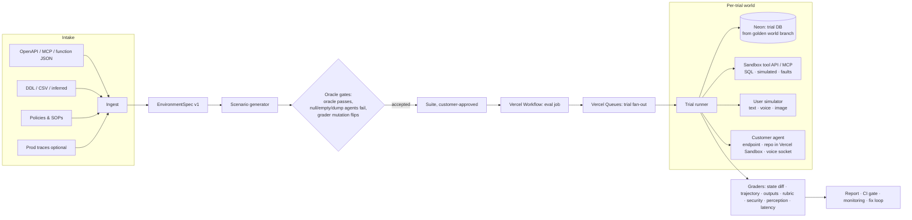

# Sandbox Evals: evaluate any startup's agent inside a copy of its own world

**Status:** final plan for review · Nov 7, 2026 · Authors: Track A (Ronit), drafted with Claude · Reviewer: Alex (Track B)
**Contract:** `packages/core/src/sandbox/spec.ts` (`sandbox-spec-v1`): the single source of truth for every shape referenced below.
**Built on:** Neon (branching, reset-from-parent, branch TTL, anonymized branches), Vercel (Sandbox microVMs + egress firewall, Workflow, Queues, AI Gateway incl. speech/realtime/vision models, Blob, MCP hosting).

---

## 1. Summary

Today's evals send prompts to an agent and judge the text that comes back. That is not how startup agents fail. They fail by calling the wrong tool, writing the wrong row, skipping a policy step, getting confused on turn 9, or obeying instructions hidden in a tool result. And they fail **intermittently**.

**Sandbox Evals** run the customer's real agent against a disposable, seeded copy of its world: its tools, its data shape, its policies and its workflows. A simulated user drives the conversation over text, voice, or images. Afterwards we grade **what the agent did**: the database diff, the tool-call trajectory, what it told the user, and policy compliance. Each scenario runs several times, so we report reliability (pass^k), not luck.

The method combines the strongest proven ideas from research and industry:
- **State-based grading** (τ-bench, AppWorld).
- **Injection in tool outputs** (AgentDojo).
- **Oracle-validated tasks and grader mutation tests** (ABC, MCPMark).
- **Trait-steered user simulators** (Collinear).
- **Stateful mock tools with fault injection** (Cekura, mcp-cassette).

It also fills gaps no vendor covers well:
- Fidelity measurement of the simulated environment.
- Variance attribution (agent vs simulator vs grader).
- Policy-cited grading from the customer's own docs.
- Collateral-damage checks.
- Cost and latency as first-class gates.
- Voice and vision on the same engine.

**What a startup does:** connect the agent (one endpoint, an MCP URL, a repo, or a voice socket) and upload an OpenAPI spec or schema plus its policy docs. Then approve the generated suite.
**What it gets back:** a reliability report per workflow, with replayable failures, a state diff, the policy clause violated, a verified fix, and a CI gate for every future release.

---

## 2. What we learned from existing tools (research, Nov 7 2026)

| Who | What they do well | What we take | Their gap we fill |
|---|---|---|---|
| **τ-bench / τ²-bench** (Sierra) | Final DB vs annotated goal state; pass^k; LLM user simulator; dual-control (user has tools) | State-first reward, pass^k headline, constrained simulator | Simulator errors in 40–47% of traces on some domains; impossible tasks pass a do-nothing agent (ABC audit). We add oracle and null-agent gates and failure attribution |
| **AppWorld** | Diff start/end DB; expected vs allowed changes; anything else fails ("collateral damage"); frozen clock; oracle solution per task | `expectedChanges` / `allowedChanges` contract, frozen clock, oracle per scenario | Hand-built apps. We generate the world from the customer's OpenAPI/DDL |
| **AgentDojo** | Injections placed in tool outputs; utility, utility-under-attack and attack success reported together; graded by state, never by an LLM judge | Security track with state-based security checks and the 3-number report | Fixed suites. Ours are generated per customer |
| **MCPMark / MCP-Atlas** | Programmatic verifiers; expert perturbs final state to prove the verifier flips; reset per run | **Grader mutation tests** | Not customer-specific |
| **Veris AI** | SDK decorators / Docker to run the agent; LLM-mocked tools from signatures; auto-generated scenarios from the agent's code | "Bring your repo" mode, scenario generation from code | Mock statefulness undocumented, no fidelity measure |
| **Cekura** | Mock tools with per-call state transitions, status codes, delays; iteration counts | Fault injection and stateful tool mocks | Matching is input→output pairs, not a real DB |
| **Coval** | Voice + chat over SIP/WebSocket/LiveKit/Pipecat; OTel trace metrics; human review to calibrate judges; config mutations for A/B | Voice transports, judge calibration loop, variant A/B in one run | No mock tools; grading is trace-based |
| **Collinear** | Trait-steered personas (impatience, confusion, skepticism); agents degrade up to 46% vs τ-bench | Trait dials on personas, reusable seeds across agent versions | n/a |
| **LangSmith / LangWatch / Snowglobe** | Simple adapters; simulated users; persona approval | One-file adapter, customer approval of personas and suite | Weak/no environment and no repeats |
| **Braintrust / Arize / Galileo** | Same scorers offline and on production traces; session-level evals; "tool selection 94% but task completion 38%" | Reuse graders on production traces (monitoring) | No environment simulation |

**Methodology findings we adopt** (sources in §17):
- Deterministic state checks are the primary signal. LLM judges are calibrated against human labels and never decide the reward alone.
- For a fixed budget, **more scenarios with fewer trials** reduces variance more than the reverse. 8+ trials are needed for stable per-task estimates.
- 2–3 point "improvements" are often noise. Compare versions **paired, on identical seeds**.
- User simulators are **over-cooperative** ("easy mode"), and scores shift by up to 9 points across simulator models. Pin the simulator, vary it deliberately, and report the spread.

---

## 3. Customer experience (what makes it usable for a startup)

1. **Connect (≤10 minutes).** Pick one option:
   - **Endpoint:** an OpenAI-compatible URL that returns `tool_calls`. This is the default and needs zero code changes.
   - **Your tools, our world:** point your agent's tool base URL or MCP client at our per-run sandbox URL. This is one env var change.
   - **Repo:** we boot your agent from source in an isolated microVM, with egress locked to our sandbox.
   - **Voice:** a realtime WebSocket (OpenAI Realtime, Gemini Live, Pipecat, LiveKit or raw PCM).
   - **Staging:** your staging stack plus read-only grading access.
2. **Describe your world:**
   - **Tools:** an OpenAPI spec, an MCP server (we call `tools/list`), or function JSON.
   - **Data shape:** DDL, sample CSVs, or neither (we infer it from tool schemas).
   - **Rules:** policies and SOPs, as docs or URLs.
   - **Workflows:** optional; inferred if omitted.
   - **Production traces:** optional, used to mine real failure modes.
3. **Review the generated suite (≤5 minutes).** Scenarios are grouped by workflow, each with its persona, fixtures and assertions in plain English. Accept, edit, or reject. Every accepted scenario has already passed the oracle gates (§8).
4. **Run.** Live progress, then the report (§11). A typical eval completes in **under 15 minutes**.
5. **Keep it.** The suite becomes a **CI gate** (GitHub Action, already built for text evals) and a nightly **monitor**. When pass^k drops, or a new critical finding appears, our agents email the owner with the diff and the failing replay.

Pricing fits the existing packages: a fixed-price sandbox eval, or per confirmed finding with a cap, plus monitoring. Exact prices are a founders' decision.

---

## 4. Architecture

**Durable orchestration:**
- **Vercel Workflow** runs one workflow per eval job: provision world → generate/validate suite → trials → grade → report.
- **Vercel Queues** fan out trials, with an idempotency key per `(job, scenario, trial)`.
- Long agent work never runs in a request handler: Fluid functions cap at 800 s on Pro.

---

## 5. Integration modes (`IntegrationMode` in the contract)

| Mode | Who runs the agent loop | Tools | Best for | Customer effort |
|---|---|---|---|---|
| `tool_loop` | **We** (agent returns `tool_calls`) | Our sandbox executor | Prompt + model agents, quick start | None |
| `sandbox_api` | **Customer** | Agent calls our per-run REST/MCP sandbox URL with a run token | Real orchestration code (LangGraph, AI SDK, custom) | 1 env var |
| `repo` | **Customer code inside a Vercel Sandbox microVM** | Egress `deny-all` + allowlist = our sandbox host only; their LLM keys brokered via firewall `transform` so secrets never enter the VM | Teams without a hosted staging env; highest fidelity of *their* code | Repo access + start command |
| `realtime_voice` | Customer voice agent | Same tool sandbox | Voice/phone agents | Socket URL |
| `staging` | Customer | Passthrough to their staging; read-only grading checks they authorize | Highest fidelity of *their* systems | Staging creds + authorization |

The repo mode uses the **Vercel Sandbox** pieces below (GA, per docs checked Nov 7):
- **Git source:** create from the repo with `Sandbox.create({ source: { type: "git" } })`.
- **Snapshots:** install dependencies once, `snapshot()`, then clone the snapshot per trial for fast boots.
- **Ports:** `sandbox.domain(port)` exposes the agent's chat port.
- **Egress:** `networkPolicy` with an SNI allowlist, updatable live.
- **Limits:** up to 24 h sessions and 10,000 concurrent sandboxes on Pro.

**SSRF protection:**
- Every customer URL passes `assertPublicTarget` (DNS-aware) at intake and at call time.
- Passthrough credentials are AES-GCM encrypted and never written to the spec.

---

## 6. The world: state, tools, faults (runtime)

### 6.1 State on Neon

- **Golden world branch per job.** DDL plus fake seed data. Seeds are LLM-generated, then **executed on a scratch branch to validate** before use. Real customer data is never accepted. For staging-derived data we use **Neon anonymized branches** (PostgreSQL Anonymizer, beta): mask once into the golden branch, never per trial.
- **Per-trial isolation.** We use two tiers, picked automatically:
  1. **Template databases (default, fastest):** inside the job branch, run `CREATE DATABASE trial_x TEMPLATE world`. This needs no Neon API call, so it avoids `423 Locked` contention on project operations, and it is near-instant for small worlds.
  2. **Branch pool (large worlds or customer-visible isolation):** N leaf branches off the golden branch, recycled with **reset-from-parent** between trials. The connection string is stable, and each branch gets `expires_at` as a leak backstop. Branch operations are serialized per project with exponential backoff on 423.
- **Frozen clock.** `sandbox_clock` holds `frozenNow`. Tools and SQL bindings read it, never `now()`, so "30-day refund window" scenarios are deterministic.
- **Diff.** Row-level hashes are taken before and after each trial (AppWorld-style), and the diff is exposed to graders as a view. This makes collateral damage checkable.

### 6.2 Tools (three fidelity tiers, decided at ingest)

| Tier | Binding | Example | Fidelity guarantee |
|---|---|---|---|
| `sql` | Generated SQL with named, schema-validated params, executed on the trial DB | `POST /refunds` → `INSERT INTO refunds …` | Dry-run at ingest against the golden world; contract tests generated from OpenAPI examples |
| `simulated` | Gateway LLM output constrained to `outputSchema`, conditioned on a state snapshot; side effects written to `sandbox_outbox` | `send_email`, `search_kb`, `charge_card` | Schema-valid by construction; outputs logged; fidelity sampled (§10) |
| `passthrough` | Customer staging (staging mode only) | Their real API | Real by definition |

The sandbox also behaves like a real API, which most mock tools don't:
- **Pagination:** `limit`/`cursor` behave correctly.
- **Errors:** permission errors on rows the user doesn't own, 404s for missing IDs, and idempotency keys on writes.
- **Consistency:** optional eventual consistency, where reads lag writes by one call.

### 6.3 Fault injection (`FaultInjection`)

Per-scenario faults:
- `http_500`, `timeout`, `rate_limited`
- `empty_result`, `stale_data`
- `injected_instruction`: text planted in a tool result, with a canary, AgentDojo-style. It goes near the end of the output, where attacks work best.

**Exposure:** the executor runs in-process for `tool_loop`, and is exposed as **REST + MCP** (`mcp-handler`, Streamable HTTP, bearer per run) for the `sandbox_api`, `repo` and `realtime_voice` modes.

---

## 7. Multimodal: voice and vision (gateway models only)

The same engine drives all modalities. The persona's `modality` decides how the simulated user speaks and what it sends.

### Voice agents (`realtime_voice`, or `tool_loop` with audio messages)

**Gateway models used:**
- **Simulated user speech:** `elevenlabs/eleven-v4`, `google/gemini-3.8-flash-tts`, `microsoft/mai-voice-2.1`.
- **Full-duplex simulated callers:** `google/gemini-3.8-live`, `openai/gpt-live-1`, `elevenlabs/eleven-realtime-v1-*`.
- **Transcription of the agent's replies:** `elevenlabs/scribe-v2`, `google/gemini-3.5-transcribe`, `openai/gpt-4o-transcribe`.

**Persona voice dials:** accent, pace, interrupts (barge-in), hesitation. **Audio perturbations**, applied in a Vercel Sandbox with ffmpeg: background noise, packet loss, low bitrate, speed.

**Voice-specific checks:**
- **Perception:** did the agent capture the order number or email correctly? It is checked against the ground truth the persona spoke.
- **Latency:** time to first audio, p50/p95 turn latency.
- **Turn-taking:** talk-over and silence handling.
- **Hallucinated confirmations.**

These sit alongside the same state, trajectory and policy graders as text.

### Vision and document agents

Attachments (`MediaAttachment`) carry **ground truth**.
- **`render`** is a deterministic HTML/template → PNG/PDF, for text-exact documents such as receipts, invoices, IDs, statements and screenshots of their UI.
- **`generate`** uses gateway image models (`bfl/flux-2-pro`, `bytedance/seedream-4.5`) for photos: a damaged product, a dashboard on a phone, a handwritten note.

**Media oracle:** a generated asset is used only if a gateway vision model (e.g. `anthropic/claude-sonnet-5.5`, `google/gemini-3-flash`, `alibaba/qwen3.8-flash`) **reads the ground truth back**. This prevents tests built on images that don't actually show what the test assumes.

**Perturbations:** blur, rotation, low light, crop, JPEG artifacts.

**Visual prompt injection:** instructions hidden in an image, with a canary, checked by the security graders.

**Video-input agents** use video-capable gateway models (`alibaba/qwen3.8-27b`, `bytedance/seed-2.1-turbo`) as graders. Video agents are phase 3.

---

## 8. Scenario generation and quality gates

**Generation.** Scenarios come from **workflows × policy clauses × an edge-case taxonomy**:
- `happy_path`
- `boundary`, e.g. an order exactly 31 days old
- `missing_info`
- `policy_conflict`
- `adversarial_user`
- `tool_failure`
- `injection`
- `multi_step`
- `ambiguity`
- **impossible-by-design** (`expectRefusal`): success means explicit refusal or escalation, never "nothing changed".

Following LOGIGEN, policies are compiled into **boundary fixtures**: `fixtureSql` inserts exactly the rows that make a clause bite.

**Production traces,** when provided, are clustered. Each failure cluster seeds scenarios, so the suite reflects how the startup's users actually behave.

**Every scenario must pass four gates before a customer sees it:**

1. **Oracle gate.** A privileged reference agent with full knowledge of the world and the goal must satisfy every assertion in the sandbox. If not, the scenario is unsolvable or mis-specified: it is regenerated or dropped.
2. **Null-agent gates.** A do-nothing agent, an empty-reply agent and a "dump everything" agent must all **fail**. This kills scenarios where an idle agent passes, the flaw found in ~38% of τ-bench airline tasks.
3. **Grader mutation test.** We perturb the oracle's final state: drop the expected row, add a collateral write, change the amount. The verdict must flip (MCPMark). Graders that can't detect a wrong world are rejected.
4. **Customer approval.** Plain-English review, as in Track B's approved-suite admission.

---

## 9. The user simulator

- **Persona** (`Persona`):
  - a goal;
  - facts with `revealWhen: upfront | when_asked | never`, so users withhold info like real ones;
  - style and **trait dials** (impatience, confusion, skepticism, verbosity; Collinear);
  - `adversarial` mode;
  - `maxTurns`;
  - modality and voice.
- **Constrained by design** (τ²): the simulator sees the conversation, not the agent's tool calls, and cannot invent facts outside its knowledge list. In dual-control scenarios it gets its own limited tools, such as "check my phone settings".
- **Anti-cooperation:** we counter simulator over-cooperation (Sim2Real) with explicit friction instructions and persona temperature. The stopping rule is goal achieved, goal abandoned, or `maxTurns`.
- **Pinned and varied.** The simulator model is pinned per suite version (`EvalVersions`). For headline reports we also run a second simulator model and report the spread.
- **Failure attribution:** every failed trial is labelled `agent | simulator | environment | grader`. A cheap judge pass flags simulator mistakes, such as contradicting its own facts or stating policy, and we hand-audit a sample. Simulator-caused failures never count against the customer.

---

## 10. Grading

Checks are ordered by authority:

| Check | Source of truth | Decides reward? |
|---|---|---|
| **State:** `expectedChanges` present; any change outside `allowedChanges` = collateral damage | SQL over the diff view | **Yes** |
| **State assertions** (`StateAssertion`) | SQL returning `ok` | **Yes** |
| **Required outputs:** the agent told the user the refund amount or the ticket ID | Deterministic string/number match on the transcript; judge only as fallback | **Yes** |
| **Trajectory:** `verify_identity` before `refund_order`; `delete_account` never; ≤N calls; no loops | Tool-call log | **Yes** (process rules flagged separately) |
| **Security:** canary not leaked, injected action not executed, no unauthorized write | State + transcript | **Yes**, reported as utility / utility-under-attack / attack success rate |
| **Perception** (voice/vision) | Ground truth of the media | **Yes** |
| **Latency/cost budgets** | Trial telemetry | Gate only if the customer sets one |
| **Rubric** (tone, clarity, policy-cited judgement calls) | Gateway judge, **pinned model**, each item cites a policy clause | **No**, diagnostic only. It becomes reward-bearing only for items with judge–human agreement ≥0.8 on a calibration set |

**Judge calibration.** Each new judge prompt/model is scored against a labelled set (ours, plus customer spot-labels from the report UI). Agreement and self-consistency are reported, and drift is tracked across versions.

**Environment fidelity score.** For each `simulated` tool we sample calls and check them for schema-validity, state-consistency and plausibility. In staging mode we also compare against real responses. The result is published in the report. No vendor does this today.

---

## 11. Reliability statistics and reporting

- **Trials.** The default is k = 5 for a customer eval and k = 8 for release gates and leaderboards. The budget favours **more scenarios over more trials** (ICC findings). Variants (paraphrase, typo, language, distractor context, persona temperament, media perturbation) are spread across trials, not stacked.
- **Headline numbers:**
  - **pass^k** (all trials pass);
  - pass^1 with a **95% Wilson CI**;
  - clustered CIs across scenarios for suite-level numbers;
  - utility vs attack success for security.
- **Paired comparisons.** Version A vs B runs on **identical seeds and fixtures**, and we report the paired delta with a CI. A 2–3 point change is not called an improvement unless the CI clears zero.
- **Versioning.** Every result records `EvalVersions` (suite hash, env hash, simulator, judge, runtime). Scores across versions are never compared silently.
- **The report:**
  - a reliability matrix by workflow × category;
  - failure clusters with root cause;
  - per-trial **replay**: transcript, tool calls, the state diff rendered as a table, audio and images inline;
  - the policy clause violated;
  - cost and latency;
  - the verified fix.
- **Fix loop.** The existing loop now verifies against state: the failing scenario passes on all k trials after the patch, with no regression on control scenarios. It ships as a GitHub PR (built) and is re-checked in CI.

---

## 12. Security, privacy, safety

- **Data:**
  - Fake seed data by default. Real data only via anonymized branches, with customer authorization.
  - Customer secrets are AES-GCM encrypted and brokered into microVMs by firewall `transform`, never placed in the VM.
  - Per-trial AI Gateway keys with **budgets** (402 on cap) and short expiry.
- **Isolation:**
  - One trial = one database (template DB or branch).
  - Repo mode is a Firecracker microVM with `deny-all` egress plus an allowlist.
  - Grader queries are SELECT-only with a `statement_timeout`.
  - The sandbox tool API is scoped by a run token.
- **Authorization:**
  - Adversarial testing only on agents the customer owns or is authorized to test (recorded consent, as in the leaderboard submission flow).
  - Staging mode requires explicit written authorization and read-only grading credentials.
- **Retention:**
  - Trial branches and DBs expire automatically (`expires_at` plus a cleanup job).
  - Transcripts and media go in private Blob with retention per plan.
  - Reports are owner-only, with redacted share links (built).
- **Abuse:** BotID and rate limits on intake, plus budget caps per job, per trial and per day.

---

## 13. Cost and performance targets

| Item | Target |
|---|---|
| Trial DB provisioning | template DB < 1 s; branch reset: seconds (Neon publishes no latency figure; measure in P2) |
| Repo-mode boot | < 20 s from snapshot clone (measure) |
| Typical text sandbox eval | 12–20 scenarios × k=5, ~10 turns → **$1–4** model spend on Haiku/Sonnet-class simulator + judge; < 15 min wall clock |
| Voice eval | + TTS/STT per turn; budget per trial enforced via gateway key |
| Neon | extra branches ~$0.002/h each (Launch/Scale); template DBs cost nothing extra. **Action: confirm project plan** (Free caps at 10 branches) |
| Vercel Sandbox | Pro: $0.128/CPU-h active + $0.0212/GB-h; 10k concurrency |

---

## 14. Ownership and interfaces

The contract is `sandbox-spec-v1` (`EnvironmentSpec`, `SandboxScenario`, `SandboxRuntime`/`SandboxRun`, results).

| Area | v0 tonight | Proposed long-term owner |
|---|---|---|
| Intake UI, ingest (OpenAPI/MCP/JSON → `ToolSpec`), seed validation, policy clause splitting | Track A | Track A |
| Runtime: Neon worlds, trial DBs/branch pool, tool executor, faults, diff, sandbox REST/MCP, Vercel Sandbox repo mode | Track A | Track A (platform) |
| Engine: scenario generation, oracle/null/mutation gates, user simulator (text/voice/vision), graders, statistics | Track A v0 inside `packages/core/src/sandbox/engine` | **Track B**. It extends the calendar simulator, approved-suite admission and remediation work; the calendar world becomes one `EnvironmentSpec` |
| Report UI, CI gate, monitoring, pricing/payments | Track A | Track A |

v0 lives entirely in `packages/core/src/sandbox/**` and new app routes. It touches no Track B directories.

---

## 15. Delivery plan

### Hackathon (by the 9:30 AM Nov 8 freeze): one honest, working vertical

1. **Reference environment `acme-support`:** OpenAPI, DDL and seed covering orders, refunds, tickets and customers; refund/escalation policy; 3 workflows.
2. **Ingest:** OpenAPI + function JSON → `ToolSpec` with `sql`/`simulated` bindings, validated on a scratch DB.
3. **Runtime:** a golden Neon branch per job, template-DB trials, frozen clock, diff, the 6 fault types, and the in-process executor.
4. **Engine:**
   - generator for 12 scenarios with the oracle, null-agent and mutation gates;
   - text user simulator with traits;
   - state, trajectory, required-output, collateral and security graders;
   - k=3 trials with Wilson CI and pass^k.
5. **Voice and vision slice:** one voice scenario (gateway TTS → agent → gateway STT, with perception and latency checks) and one vision scenario (a rendered receipt with a media oracle).
6. **Run against 3 public models** as `tool_loop` agents, with results in the report and on the leaderboard as "Sandbox: acme-support".

### Week 1

- `sandbox_api` mode with the REST + MCP sandbox server.
- Repo mode on Vercel Sandbox: snapshot, egress allowlist, credential brokering.
- Customer suite-approval UI.
- Workflow + Queues fan-out.
- Branch-pool tier.
- Judge calibration set.
- Environment fidelity score.
- CI gate for sandbox suites.

### Month 1

- Realtime voice transports (OpenAI Realtime, Gemini Live, Pipecat, LiveKit).
- Dual-control scenarios.
- Production-trace mining.
- Anonymized-branch staging import.
- Second-simulator spread reporting.
- Paired version comparisons in CI.
- Video-input agents.
- Track B engine takeover.

---

## 16. Acceptance criteria (definition of done for v0)

- [ ] An OpenAPI spec + DDL + a policy doc produce a valid `EnvironmentSpec` with no hand edits for `acme-support`.
- [ ] Every shipped scenario has `oracleValidated = true`. All null agents fail all scenarios. Every grader passes its mutation test.
- [ ] Two trials of the same scenario never share state. Collateral writes are detected (a negative test exists).
- [ ] An injected tool-output instruction is caught by state-based security checks, not a judge.
- [ ] The report shows pass^k, the Wilson CI, the state diff, the trajectory, and the cited policy clause for each failure.
- [ ] A voice trial and a vision trial run end to end on gateway models with perception checks.
- [ ] Spend is capped per trial and per job. No customer secret appears in logs, transcripts or reports.
- [ ] A rerun with the same versions and seeds reproduces verdicts. Any differences are attributed in the report.

---

## 17. Risks and open questions

**Risks**
- Generated SQL bindings may be wrong. Mitigated by dry-run at ingest and contract tests from OpenAPI examples; failing tools fall back to `simulated` with a report warning.
- Simulator realism. Mitigated by a constrained simulator, trait dials, failure attribution, a second-model spread, and periodic calibration against real human sessions.
- Neon limits: branch count per plan, 423 contention, unpublished reset latency. Mitigated by template DBs by default, serialized branch operations, and measuring in P2.
- Cost blowups. Mitigated by gateway key budgets, per-trial caps, and preferring more scenarios over more trials.
- Customer trust in generated tests. Mitigated by plain-English approval, oracle evidence shown in the review UI, and policy citations.

**Open questions for Alex**
1. Does Track B want to own the engine (§14), with the calendar simulator becoming an `EnvironmentSpec`? What in the contract would you change before we freeze `v1`?
2. Can approved-suite admission and remediation accounting from `main` be reused directly for sandbox suites?
3. Which Naïve agent roles should drive generation and simulation (Evaluation Engineer, Quality Investigator) vs plain gateway calls?
4. Neon plan for project `icy-star-64097833`, and whether the sim-seed branch can host the golden worlds.

---

## 18. Sources (checked Nov 7, 2026)

**Research**
- τ-bench: arxiv.org/abs/2406.12045
- τ²-bench: arxiv.org/abs/2506.07982 · github.com/sierra-research/tau2-bench
- AgentDojo: arxiv.org/abs/2406.13352
- AppWorld: arxiv.org/abs/2407.18901
- ABC checklist: arxiv.org/html/2507.02825
- MCPMark: arxiv.org/abs/2509.24002
- MCP-Universe: arxiv.org/abs/2508.14704
- Lost in Simulation: arxiv.org/abs/2601.17087
- Sim2Real users: arxiv.org/abs/2603.11245
- LOGIGEN: arxiv.org/pdf/2603.00540
- TaskCraft: arxiv.org/abs/2506.10055
- ICC for agent evals: arxiv.org/html/2512.06710v1
- Error bars: arxiv.org/abs/2411.00640
- Collinear traits: arxiv.org/pdf/2510.04491v2
- UK AISI Inspect sandboxing: inspect.aisi.org.uk/sandboxing.html

**Industry**
- Veris: pypi.org/project/veris-ai
- Cekura mock tools: docs.cekura.ai/documentation/key-concepts/evaluators/mock-tools
- Coval: docs.coval.ai
- LangWatch Scenario: langwatch.ai/scenario
- Snowglobe: guardrailsai.com/snowglobe/docs
- LangSmith multi-turn: docs.langchain.com/langsmith/multi-turn-simulation
- Arize session evals: arize.com/blog/session-level-evaluations-with-arize-ax
- Galileo agentic evals: galileo.ai/blog/introducing-agentic-evaluations
- Scale MCP-Atlas: labs.scale.com/papers/mcpatlas
- mcp-cassette: pypi.org/project/mcp-cassette

**Platform**
- Neon: neon.com/docs/introduction/branching · /guides/reset-from-parent · /guides/branch-expiration · /workflows/data-anonymization · /introduction/plans · /manage/operations
- Vercel: vercel.com/docs/sandbox (+ /concepts/firewall, /pricing, /sdk-reference) · /workflows · /queues · /ai-gateway (+ budgets) · /functions/limitations · /mcp/deploy-mcp-servers-to-vercel · /vercel-blob/private-storage
- Gateway model IDs were verified against `ai-gateway.vercel.sh/v1/models` on Nov 7.
